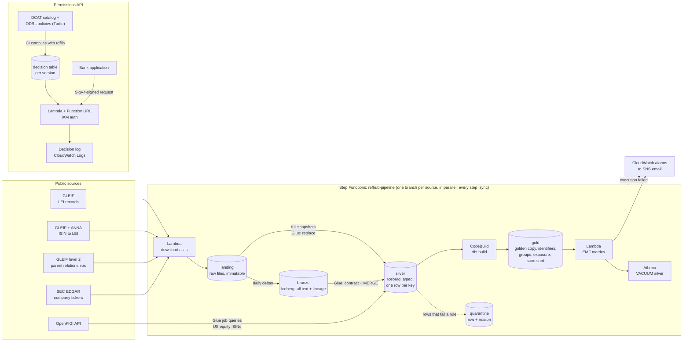

# third-party-reference-data-hub

A small, working **third-party reference data hub** on AWS: it ingests public registries (GLEIF,
SEC EDGAR, OpenFIGI), resolves them into one **golden copy of companies and their identifiers**,
groups companies by their **ultimate parent**, and answers **"may this application use this
dataset for this purpose?"** from machine-readable licenses.

It is a portfolio project built at small scale with real public data. Every figure below was
measured on the deployed pipeline (Athena, AWS CLI) or is cited with its source. The rest of the
documentation (ADRs, runbooks, postmortems) is in Spanish; there is a short Spanish summary at the
end of this page.

## The problem

A bank knows the same counterparty under different codes depending on the desk: the **LEI** in
lending, the **ISIN** of each bond in investments, a **ticker or FIGI** in trading, the **CIK** in
credit research on US issuers. To answer "if this group defaults, how much do we lose?" someone has
to say that all those codes are the same company, and which companies belong to the same group.

The LEI was created after 2008 for exactly this, but on its own it is not enough:

- **It identifies legal entities, not securities.** Bonds and shares carry ISINs; the link
  ISIN↔LEI is a separate file.
- **Not every company has one, and not every source reports it.** The SEC does not publish the LEI
  of its registrants (the field came back empty for 50 of 50 companies sampled, ADR 0008), so
  CIK↔LEI has to be inferred.
- **Registry data has its own quality issues.** In the GLEIF full file of 2026-10-10, 34.9 % of
  the records were `LAPSED` (not renewed). Records can go *backwards*: a transfer between
  registrars that falls through republishes an older record (see postmortem 0001).

On top of that, external data comes with **licenses**. Some sources can be used for anything,
some ask to be cited, a market data feed typically forbids redistribution and non-display use.
A bank has to be able to show that each use of a dataset, *including data derived from it*, is
within what its license allows.

## What the hub does

1. **Ingests four public sources** to an immutable landing zone, every file stored as received.
2. **Validates and deduplicates** them into typed Iceberg tables (silver). Rows that break the
   contract go to a quarantine table with the rule that failed; they are never dropped.
3. **Builds the golden copy** with dbt: one row per SEC company with its LEI, which path found it
   (published codes or normalized name), and explicit `conflict` / `ambiguous` flags. Plus a long
   cross-reference table (CIK, LEI, ISIN, FIGI, ticker).
4. **Groups companies by ultimate parent** from GLEIF level 2 data, and sums a (synthetic) loan
   portfolio per group.
5. **Answers license questions**: a DCAT catalog and ODRL policies, compiled in CI into a decision
   table and served by a private, IAM-authenticated Lambda that logs every decision.
6. **Watches itself**: a data quality scorecard, six CloudWatch metrics, email alarms, and Iceberg
   snapshot cleanup, all inside one Step Functions pipeline.

## Architecture



- **Storage:** one S3 bucket with a prefix per layer; Iceberg tables in the Glue Data Catalog;
  Athena for SQL (a workgroup that cancels any query reading more than 1 GB).
- **Compute:** Lambda downloads, Glue 5.1 (Spark) writes bronze and silver, dbt on Athena builds
  gold inside CodeBuild. No servers running between pipeline runs, no VPC.
- **Measured end to end:** the full pipeline ran with every step green on 2026-10-21
  (`prueba-completa-20261022T021256`) in **31 min 38 s**: the four source branches in parallel
  8 min 3 s (the longest is ISIN↔LEI followed by OpenFIGI), dbt in CodeBuild 2 min 39 s, metrics
  9 s, and the Iceberg `VACUUM` of the 10 silver tables 20 min 47 s. That last step runs one table
  at a time and each Athena step waits about a minute in Step Functions, although every query
  finishes in under 4 s; it costs nothing extra (Standard workflows bill per transition, not per
  minute), but it is the obvious place to shorten the run.
- **Delivery:** every change goes through a pull request; CI posts `terraform plan` on the PR and,
  on merge, builds the package once, publishes it to S3 under an immutable version and runs
  `terraform apply`. GitHub authenticates to AWS with OIDC (no stored keys), with a read-only role
  for PRs and a separate apply role for `main`.

## Sources and licenses

Verified on the official sites on 2026-10-21. Summary only; the source text prevails. Details and
quotes: [`docs/licencias-fuentes.md`](docs/licencias-fuentes.md).

| Source | What the hub takes | License (as published) | Duty modeled in ODRL |
|---|---|---|---|
| [GLEIF LEI data](https://www.gleif.org/en/meta/lei-data-terms-of-use) | LEI records: daily deltas and the full file (3.46 M LEIs) | CC0 | none |
| [GLEIF + ANNA ISIN↔LEI](https://www.gleif.org/en/lei-data/lei-mapping/download-isin-to-lei-relationship-files) | Which ISINs each LEI issued (9.37 M rows) | No named license found; described by GLEIF and ANNA as open and free, modeled as any use | none |
| GLEIF level 2 relationships | Who consolidates whom (491 k relationships) | Same GLEIF terms of use (CC0 for the data of the Global LEI Repository; the terms do not name level 2 explicitly) | not in the catalog yet |
| [SEC EDGAR](https://www.sec.gov/privacy) | `company_tickers_exchange.json` (10,443 tickers, 8,029 companies) | Public information; the SEC asks to be cited as the source | cite the SEC |
| [OpenFIGI](https://www.openfigi.com/docs/terms-of-service) | FIGI and ticker for US equity ISINs | FIGI identifiers dedicated to the public domain | none |
| Price feed, **FICTITIOUS** | Not ingested. Exists only to show a market-data-style license | Internal display for the subscribed app only, no non-display use, derived data internal only, no redistribution | (prohibitions) |

The fictitious provider is declared as such in the policy file itself and uses no real vendor name.

## Results (measured)

### Golden copy: SEC companies resolved to an LEI

Measured in Athena on `refhub_gold_dev.scorecard_cruce`, which the pipeline rebuilds on every
run, after the full run of 2026-10-21 (`prueba-completa-20261022T021256`).

| | Companies | Share |
|---|---:|---:|
| SEC companies (one row per CIK) | 8,029 | 100 % |
| **With an LEI** | **4,245** | **52.9 %** |
| via published codes (ticker → OpenFIGI → ISIN → LEI) | 2,686 | 33.5 % |
| via normalized legal name (fallback) | 1,559 | 19.4 % |
| Both paths disagree (codes win, flagged `conflict`) | 54 | 0.7 % |
| Left **without** an LEI because several candidates tie (`ambiguous`) | 19 | 0.2 % |
| No candidate at all | 3,765 | 46.9 % |

The cross-reference table `gold.identificadores` has 605,966 rows: 579,718 ISINs, 10,443 tickers,
8,029 CIKs, 4,245 LEIs and 3,531 FIGIs. Example: Apple Inc. (CIK `0000320193`) resolves to LEI
`HWUPKR0MPOU8FGXBT394` through the codes path.

How it decides ([ADR 0008](docs/adr/0008-golden-copy.md)): codes first, name only as a fallback
(and only US LEIs or LEIs that issued securities, so a same-name company abroad does not win);
ties broken by "issued securities", then `ISSUED`, then US; **if a tie remains, no LEI is
assigned**: a false link adds exposure to the wrong company, which is worse than a missing one.
The rules are covered by dbt unit tests with invented rows, one per case.

### Precision and recall

Coverage is not accuracy. Measured on 2026-10-22 against a **gold set of 100 SEC companies drawn
at random** (fixed seed) and labeled **blind**: the labeler never saw what the hub chose. The
labeler was an AI agent working only from GLEIF's public API and SEC EDGAR, with the evidence for
every row kept (same legal name or a former one, and matching jurisdiction or address; a parent
or a subsidiary does not count). A person audited 10 random labels against GLEIF and EDGAR:
**10 of 10 agreed** (with 10 cases, that puts the labeler's agreement at 72% – 100%). Result: 73
companies have an LEI, 27 do not, 0 left undecided. Margins are 95% Wilson intervals.

| Path | Assigned | Correct | Precision | 95% CI |
|---|---:|---:|---:|---|
| By codes | 41 | 41 | 100% | 91.4% – 100% |
| By name | 22 | 21 | 95.5% | 78.2% – 99.2% |
| **Total** | **63** | **62** | **98.4%** | 91.5% – 99.7% |

**Recall: 62 of the 73 companies that have an LEI, 84.9%** (95% CI 75.0% – 91.4%). None of the
27 companies without an LEI got one assigned.

What the 12 cases that did not come out right teach:

- **The only wrong link (Hydro One):** the name path picked the subsidiary that issues the bonds.
  The tie-break prefers the entity that issued securities, and in a holding structure the debt is
  often issued by a subsidiary, not by the listed parent.
- **7 misses are a deliberate trade-off:** foreign issuers quoted in the US (six Canadian, one
  Cayman) whose names match exactly, but whose LEI is not American and has no securities in the
  ISIN↔LEI file. The rule that keeps them out is the one that stops a same-name company abroad
  from winning (Chevron vs. a Maltese "Chevron Limited"): high precision, paid for in recall.
  Next step: accept a foreign LEI when its jurisdiction matches the SEC's place of incorporation.
- **1 miss** has its GLEIF legal name in Japanese script, so its normalized Latin name is empty;
  GLEIF's transliterated names, not loaded yet, would fix it. **1** was renamed and redomiciled.
  **1** is no longer in the SEC list it was drawn from.

## Permissions API

`POST` to a private Lambda Function URL (`AuthType = AWS_IAM`, every request SigV4-signed; an
unsigned request gets `403`). Names come from the catalog; an unknown name is a `400` that says
which one, never a silent "no".

The fictitious price feed denies algorithmic trading to the trading engine:

```json
{"app": "motor_trading", "dataset": "precios_ficticios", "proposito": "trading_algoritmico"}
```

```json
{"permitido": false, "motivo": "prohibicion",
 "regla": "https://refhub.example.org/politica/ficticio_prohibe_non_display",
 "obligaciones": [], "decidido_en": "precios_ficticios", "version_politicas": "<version>"}
```

The golden copy may be used for credit risk, **with the duty to cite the SEC**, inherited through
lineage because it is built from SEC data:

```json
{"app": "riesgo_corporativo", "dataset": "gold_empresas", "proposito": "riesgo_credito"}
```

```json
{"permitido": true, "motivo": "permiso",
 "regla": "https://refhub.example.org/politica/producto_hub_cualquier_uso",
 "obligaciones": ["https://refhub.example.org/politica/sec_citar_la_fuente"],
 "decidido_en": "gold_empresas", "version_politicas": "<version>"}
```

Semantics ([ADR 0009](docs/adr/0009-catalogo-y-licencias.md)): prohibitions override permissions
(deny-overrides), no explicit permission means no (default deny), purposes follow a hierarchy,
and a derived dataset inherits the restrictions and duties of every source upstream. CI evaluates
all application × dataset × purpose combinations (432 today) into a decision table published with
each version; the Lambda only looks up a row, so every answer says which policy version produced
it and can be reproduced later ([ADR 0012](docs/adr/0012-api-de-permisos.md)). Each decision is
logged as one JSON line with the signing IAM principal.

## Exposure by economic group

`gold.grupos` maps every LEI to its **ultimate parent as published by GLEIF** (a join, no
recursion): 3,460,622 LEIs, 133,250 of them with an ultimate parent. Only accounting consolidation
forms a group; fund management, sub-funds, feeders and branches do not
([ADR 0013](docs/adr/0013-exposicion-por-grupo.md)).

`gold.exposicion_por_grupo` sums a loan portfolio per ultimate parent. **The portfolio is
synthetic and declared as such**: real LEIs with invented amounts, products and loans
(296 loans to 281 LEIs, generated with a fixed seed by `dbt/seeds/generar_cartera.py`). It is
shaped so the question makes sense (several small loans to subsidiaries of the same group). **The
exposure figures it produces are not findings** and are not reported here; they only show that the
aggregation works.

## Running it

The runbook (Spanish) covers everything from an empty AWS account:
[`infra/terraform/README.md`](infra/terraform/README.md), section *Levantar todo desde cero*
(bootstrap, backend, first publish, apply), then *El pipeline* to run it by hand. Gold alone:
[`dbt/README.md`](dbt/README.md).

Requirements: an AWS account in `us-east-1`, Terraform ≥ 1.10, AWS CLI, [uv](https://docs.astral.sh/uv/)
and Python 3.12. Locally, `uv run pytest` runs the business-rule tests (143, no AWS needed).

Two local consumers of the golden copy run in Podman: an OpenSearch counterparty search (fuzzy
names, exact lookup by any identifier, Query DSL) and an Oracle Free risk system that walks the
consolidation tree with `CONNECT BY` and recursive `WITH`, compared against the published ultimate
parent: [`local/README.md`](local/README.md) (Spanish).

## Costs

Building everything so far moved the account's credit balance from 177.44 USD (2026-09-27, before
any hub resource) to 176.78 USD (2026-10-21). The end-to-end run of 2026-10-21 cost about 0.21 USD, measured
(Glue 0.19 USD, CodeBuild and Athena about a cent each); a run with more new data cost 0.32 USD of
Glue the same day. That is why the daily schedule stays off. Measured and estimated figures, sources, and the defaults that keep it cheap (10 USD
budget, 1 GB cap per Athena query, log retention, no NAT or VPC endpoints):
[`docs/costos.md`](docs/costos.md).

## Design decisions (ADRs)

| # | Decision |
|---|---|
| [0001](docs/adr/0001-alcance.md) | Scope: a small-scale reference data hub with real public sources; paid data, Kubernetes and Neptune out. |
| [0002](docs/adr/0002-guardar-archivo-crudo.md) | Keep every provider file untouched in landing before processing it. |
| [0003](docs/adr/0003-state-remoto-y-ambientes.md) | Terraform state in S3 with a lock file, a separate bootstrap, one environment ready for more. |
| [0004](docs/adr/0004-ingesta-con-step-functions.md) | Ingestion: a Lambda that only downloads, idempotent per file, event-time partitions, schedule created disabled. |
| [0005](docs/adr/0005-cambios-por-pull-request.md) | Every change by pull request: plan on the PR, apply from CI, OIDC with two roles. |
| [0006](docs/adr/0006-bronze-silver-iceberg.md) | Bronze and silver on Iceberg: schema as SQL DDL, row rules with quarantine, the latest published file wins, versioned artifacts. |
| [0007](docs/adr/0007-evolucion-de-esquema-y-reprocesos.md) | Schema evolution and reprocessing: additive changes applied by the owning job, an explicit full refresh, expand/contract. |
| [0008](docs/adr/0008-golden-copy.md) | Golden copy: CIK↔LEI entity resolution, codes before names, ambiguity left unresolved, gold in dbt. *(proposed)* |
| [0009](docs/adr/0009-catalogo-y-licencias.md) | Catalog in DCAT and licenses in ODRL, evaluated in process with rdflib. |
| [0010](docs/adr/0010-sin-neptune.md) | No Neptune: a graph of a few thousand triples does not need a graph server. |
| [0011](docs/adr/0011-dbt-en-el-pipeline.md) | dbt runs in CodeBuild, started by Step Functions; metrics, alarms and VACUUM in the same pipeline. *(proposed)* |
| [0012](docs/adr/0012-api-de-permisos.md) | Permissions API: policies compiled in CI, a Lambda with an IAM Function URL, a decision log. |
| [0013](docs/adr/0013-exposicion-por-grupo.md) | Exposure by economic group from the published ultimate parent; synthetic portfolio, declared. *(proposed)* |
| [0014](docs/adr/0014-consumidores-locales.md) | Two local consumers in Podman (OpenSearch search, Oracle hierarchy queries), not managed services. *(proposed)* |

Postmortems (blameless): [0001 · silver kept a version GLEIF no longer published](docs/postmortems/0001-version-que-gana.md)
· [0002 · the documented reprocess did not recompute](docs/postmortems/0002-reproceso-que-no-recalculaba.md).

## Known limitations

- **Foreign issuers.** Roughly a fifth of SEC registrants are foreign; their US ticker is often an
  ADR whose ISIN may belong to the depositary bank, and their GLEIF name may be in another language
  or script. Many of them end without an LEI.
- **Companies without an LEI** end up looking the same as companies whose LEI was not found.
- **Exact name matching only.** No fuzzy matching until the gold set shows it is needed.
- **Direct parent without an ultimate parent:** 7,483 companies declare only a direct parent; they
  are treated as the head of their own group. Ownership percentages are not available in GLEIF
  level 2, so a group is all or nothing.
- **The daily schedule is off, on purpose.** It exists, but a daily run would cost an estimated 6 to 10 USD
  a month against a 10 USD budget, so the pipeline is run by hand.
- **One environment (`dev`).** The code is ready for more (names and state per environment), but
  promotion between environments has not been exercised.
- **Decision logs are kept 14 days**, like every log in the hub. A bank would keep them for years.
- **The calling application is self-declared** in the permissions API; the IAM identity is
  verified and logged, but not yet bound to an application.

## Resumen en español

Un hub de datos de referencia de terceros, chico y funcionando en AWS, con datos públicos reales.
Baja GLEIF, la relación ISIN↔LEI, las relaciones de control de GLEIF, la SEC y OpenFIGI; los
guarda tal cual en landing, los valida y deduplica en tablas Iceberg (bronze y silver, con
cuarentena) y arma con dbt la golden copy: de 8.029 empresas de la SEC, 4.245 (52,9 %) quedaron
con LEI, primero por códigos publicados y después por nombre, sin adivinar cuando hay empate.
Agrupa empresas por su controlante final y suma una cartera **sintética** por grupo (sus cifras no
son hallazgos). Las licencias están en DCAT y ODRL, se compilan en el CI y una API privada responde
si una aplicación puede usar un dataset para un propósito, con la regla y las obligaciones. Todo
corre de punta a punta en un pipeline de Step Functions (medido el 21-oct: 31 min 38 s, unos
0,21 USD), con infraestructura en Terraform aplicada por PR. Contra un
gold set de 100 empresas al azar, etiquetado a ciegas (una persona auditó 10: coincidieron los 10), el cruce tiene **98,4 % de precisión** (62 de
63; IC 95 %: 91,5 % a 99,7 %) y **84,9 % de recall** (62 de 73; IC 95 %: 75,0 % a 91,4 %). Las
decisiones están en `docs/adr/`, los costos en `docs/costos.md` y dos postmortems en
`docs/postmortems/`.
